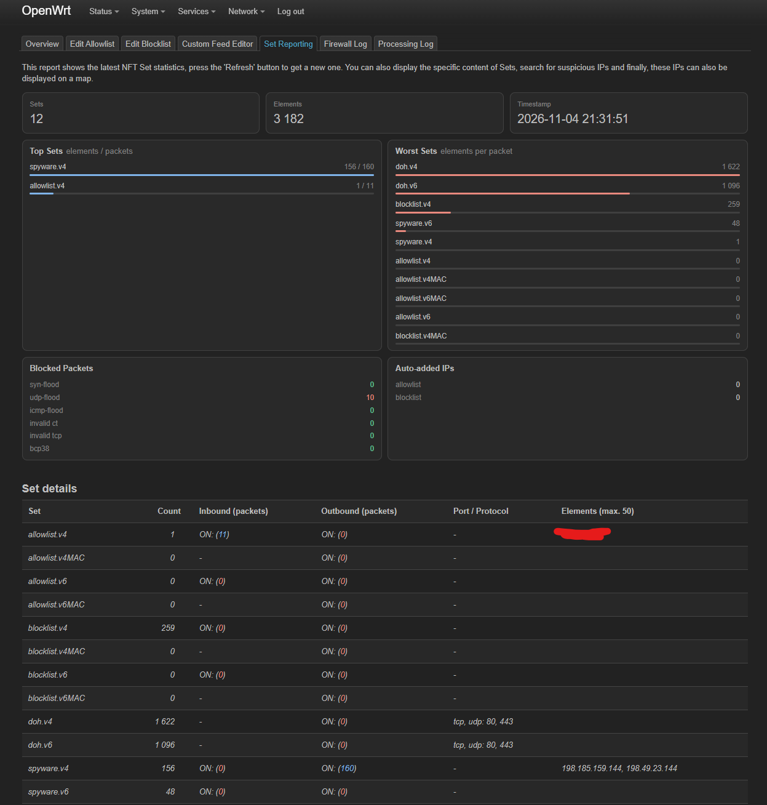

# Aggregator

This script aggregates blocklists of a known spyware infrastructure, does a DNS lookup for both IPv4 and IPv6 addresses over all the domains in the blocklists and produces a simple line-by-line text file with addresses ready to paste into a router's block list(e.g. OpenWRT with BanIP)

## First Caught

Despite the fact that some beings dispute the false-positivity of the indicator, which is in connection with the IP address present on the list, I believe that there may be some kind of secret deal between the hosting providers present on the list and the companies that operate the software we're trying to block. I will keep them on the list.

Also, there was no legitimate action on my network that would explain why the connections with those servers were made, like visiting the webpages of this provider.